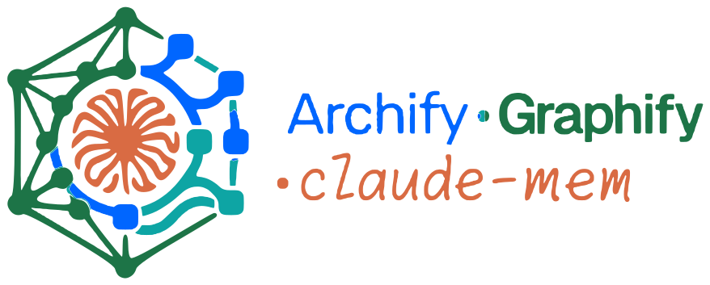
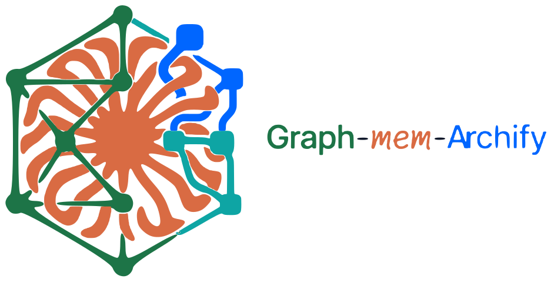

<p align="center">
  <picture>
    <source media="(prefers-color-scheme: dark)" srcset="assets/logo-archify-graphify-mem-dark.svg" />
    
  </picture>
</p>

<h3 align="center">Deterministic AST Knowledge Graph + Persistent Agent Memory + Interactive HTML Diagrams</h3>

<p align="center">
  <a href="https://santanaluiz181-cell.github.io/graph-mem-archify/"></a>
  
  
  
</p>

<p align="center">
  <picture>
    <source media="(prefers-color-scheme: dark)" srcset="assets/logo-graph-mem-archify-dark.svg" />
    
  </picture>
</p>

---

**`graph-mem-archify`** is a unified Agent Skill & CLI tool built by fusing three complementary open-source ecosystems into a single zero-waste workflow:

1. **Graphify AST + PonyTail** builds `.graphify.json` deterministically (`0` LLM tokens) with exact `file:line` symbol pointers and hub centrality.
2. **Claude-Mem Bridge** compresses the graph into `.graphify_memory.md` (`65–85%` fewer tokens than reading raw files) and syncs with `claude-mem` (`http://localhost:37777`).
3. **Archify HTML Generator** reads the compressed graph directly (never re-scanning raw repositories) to emit an interactive standalone `.archify/architecture.html` with **Lens Search**, **Path Trace**, **Dark/Light Mode**, and **PonyTail `file:line` Inspector**.

---

## Credits & Upstream Attribution

This project is explicitly a **synthesis and bridge** inspired by and built atop the concepts of three original open-source repositories:

| Upstream Project | Role in This Fusion | Original Repository |
| :--- | :--- | :--- |
| **Graphify** | Deterministic AST parsing, dependency edges & knowledge graph | [Graphify-Labs/graphify](https://github.com/Graphify-Labs/graphify) |
| **Claude-Mem** | Cross-session compressed memory & observation daemon | [thedotmack/claude-mem](https://github.com/thedotmack/claude-mem) |
| **Archify** | Interactive HTML system diagrams, path tracing & code-linked boxes | [tt-a1i/archify](https://github.com/tt-a1i/archify) |

---

## Architecture Pipeline

```text
[Source Code]
     │  (0 LLM tokens — deterministic AST scan)
     ▼
[src/indexer.mjs] ─────────► .graphify.json (hubs, resolved local edges, file:line symbols)
     │
     ├─────────────────────► [src/memory-bridge.mjs] ──► .graphify_memory.md + claude-mem (:37777)
     │
     └─────────────────────► [src/archify-diagram.mjs] ─► .archify/architecture.html (Interactive Map)
```

---

## Quick Start

### 1. Run the CLI on Any Repository
```bash
git clone https://github.com/santanaluiz181-cell/graph-mem-archify.git
cd graph-mem-archify

# Index + compress to memory + generate interactive HTML diagram
node src/cli.mjs /path/to/your-project --project MyProject
```

### 2. Install as an Agent Skill
Copy [`SKILL.md`](SKILL.md) to your agent skills folder (`~/.gemini/config/skills/graph-mem-archify/SKILL.md` or `~/.claude/skills/graph-mem-archify/SKILL.md`) and invoke `/graph-mem-archify`.

### 3. Run Automated Tests (Including Negative Assertions)
```bash
npm test
```

---

## Brand & SVG Assets

All vector emblems and Light/Dark lockups in [`assets/`](assets/) were extracted cleanly as pure SVGs from the custom tri-logo fusion artwork:

- [`assets/logo-emblem-v1.svg`](assets/logo-emblem-v1.svg) & [`assets/logo-emblem-v2.svg`](assets/logo-emblem-v2.svg) — Isolated emblem SVGs (app icon & favicon)
- [`assets/logo-archify-graphify-mem.svg`](assets/logo-archify-graphify-mem.svg) (`-dark.svg`) — Primary hero lockup
- [`assets/logo-graph-mem-archify.svg`](assets/logo-graph-mem-archify.svg) (`-dark.svg`) — Compact horizontal lockup
